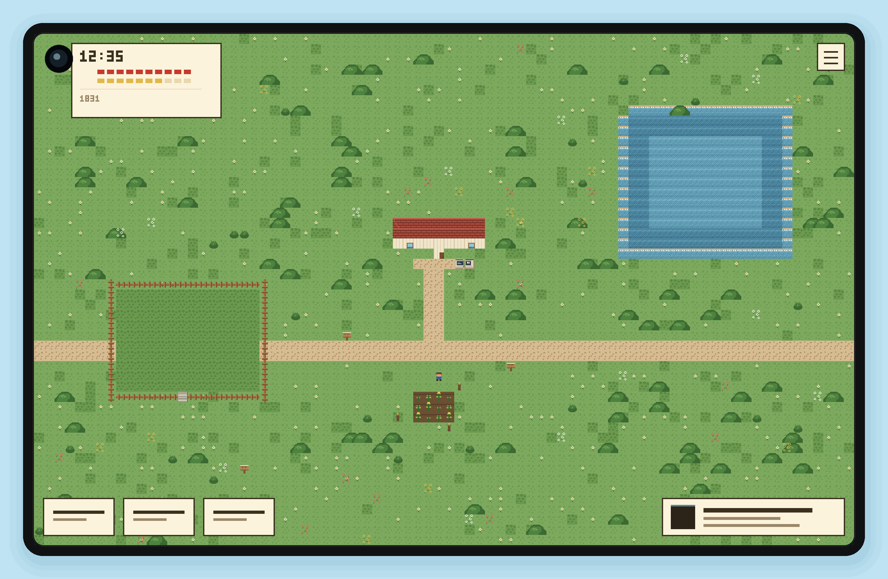
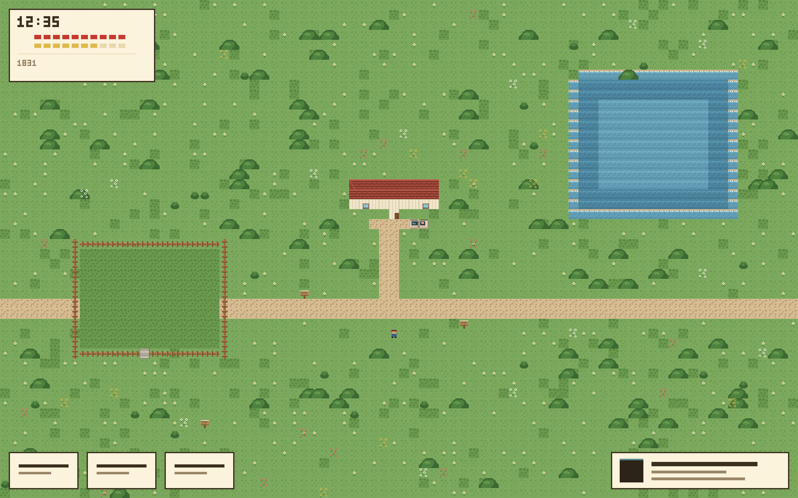
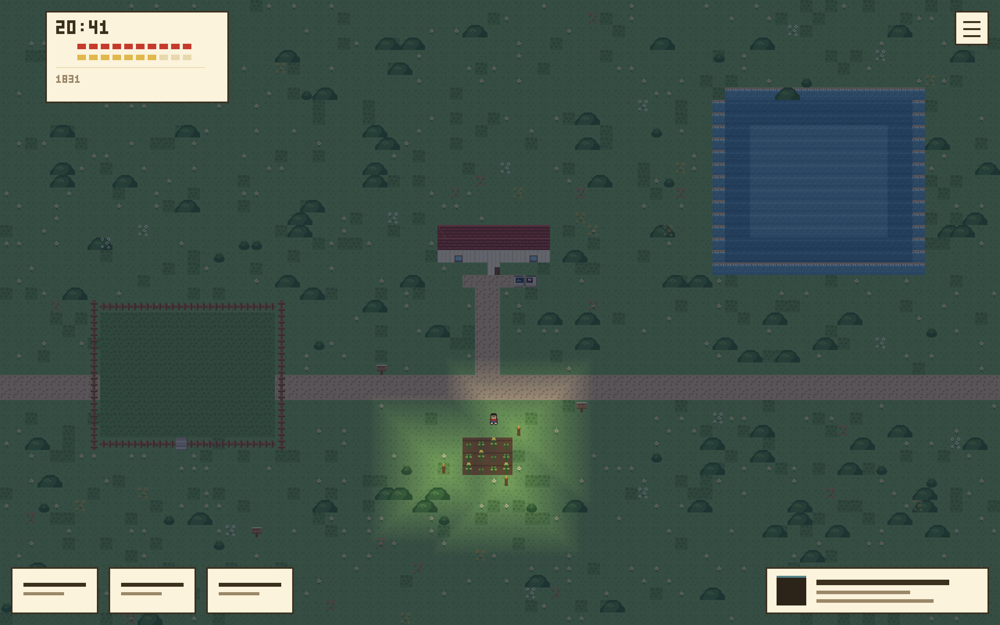

# PokeLauncher

Launcher Android native bergaya **Pokémon HeartGold / SoulSilver**: home screen pengganti dengan
enam slot "party", app drawer, jam HeartGold, dan setelan tampilan. Seluruh ilustrasi
(langit Johto, bukit, Poké Ball, kartrid GBA) digambar dari kode Compose — tanpa aset berhak cipta.



> Layar **kosong** di dalam bezel hitam **Huawei MatePad Mini** (8.8", 2560 × 1600, 343 ppi,
> bezel ~4.4 mm), landscape, di atas latar biru cerah. Gambarnya 2772 × 1812: layar 2560 × 1600,
> ditambah bezel 34 px dan margin biru 72 px di setiap sisi. Kanvasnya sengaja dikosongkan: UI sedang
> dibangun ulang tahap demi tahap. Pratinjau desain dari `tools/render_tablet.py`, bukan
> tangkapan emulator.

### Perilaku di layar besar

| Lebar layar | Layout |
| --- | --- |
| < 700 dp | Kartu pemain bertumpuk (tombol APLIKASI selebar kartu), grid 2/3/4 kolom sesuai setelan |
| ≥ 700 dp | Kartu pemain satu baris dengan tombol di kanan, enam kartrid sejajar, blok party di tengah, status card satu baris, setelan jadi panel samping 380 dp |

### Huawei MatePad Mini (HarmonyOS 4.3)

HarmonyOS **4.3.0 masih berbasis AOSP dan melaporkan API 31 (Android 12)**, jadi APK Android
dipasang dan dijalankan native — tidak perlu HarmonyOS NEXT / AppGallery. Beberapa konsekuensinya:

| Hal | Perilaku di HarmonyOS 4.3 | Status di project |
| --- | --- | --- |
| minSdk / targetSdk | 26 / 35 | Aman: semua API yang dipakai ≤ API 31 |
| Ikon adaptive | didukung sejak API 26 | vector v26 + fallback PNG |
| Splash screen | memakai `values-v31` (windowSplashScreen*) | otomatis aktif |
| Ikon monokrom (tema) | hanya v33 | diabaikan, fallback ke ikon biasa |
| `ACTION_HOME_SETTINGS` | sering tidak tersedia di EMUI | dicoba berurutan: intent EMUI → AOSP → default apps → detail app; kalau semuanya gagal muncul panduan manual |
| Google Play Services | tidak ada | project tidak memakai GMS sama sekali |
| `predictive back` / `POST_NOTIFICATIONS` | API 33 | tidak dipakai (dijaga `tools/verify.py`) |

Cara paling cepat: menu **START → JADIKAN HOME DEFAULT → JADIKAN HOME**. Tombol itu memakai
`RoleManager.createRequestRoleIntent(ROLE_HOME)` (API 29+, tersedia di HarmonyOS 4.3) sehingga
dialog izin muncul langsung tanpa membuka Setelan. Kalau role manager tidak tersedia, aplikasi
jatuh ke intent Setelan EMUI; kalau itu juga tidak ada, muncul panduan manual di bawah.

Panduan manual jika dialog sistem tidak muncul: **Setelan → Aplikasi → Aplikasi default →
Aplikasi layar utama → PokeLauncher**, atau **Setelan → Aplikasi → PokeLauncher → Buka secara
default → Layar utama**, lalu tekan tombol Home.

MatePad Mini dipakai **landscape**: 853 dp, jadi selalu masuk layout lebar. Di portrait (533 dp)
launcher akan memakai layout ponsel, tetapi pratinjau di repo hanya menyajikan landscape.

---

## Isi repo

```
app/src/main/java/dev/retrobit/pokelauncher/
├── MainActivity.kt              Activity tunggal, entry point HOME
├── data/
│   ├── Models.kt                AppEntry, PartySlot, LauncherSettings, LauncherUiState
│   ├── PartyRules.kt            Aturan party 6 slot (murni Kotlin, ada unit test)
│   └── LauncherRepository.kt    PackageManager, prefs, cache ikon
├── ui/
│   ├── LauncherScreen.kt        Root: layar home kosong + semua modal
│   ├── LauncherViewModel.kt     StateFlow tunggal, semua I/O di Dispatchers.IO
│   ├── components/              HgPanel, HgButton, AppIcon, Pokeball, ikon vektor
│   ├── screens/                 App drawer, settings, menu sheet, app info, dialog
│   └── theme/                   Palet HeartGold + 3 font pixel
└── res/                         strings (id + en), tema, ikon adaptive
tools/                           Skrip verifikasi, render & server pratinjau
docs/                            Render MatePad Mini (landscape)
licenses/                        Lisensi OFL untuk font
```

## Cara build

Butuh Android Studio **Ladybug** (AGP 8.7) atau lebih baru, JDK 17.

```bash
# dari Android Studio: File > Open > folder ini, lalu Run
# atau dari terminal:
./gradlew assembleDebug        # APK debug di app/build/outputs/apk/debug/
./gradlew test                 # unit test PartyRules
./gradlew assembleRelease      # perlu signing config sendiri
```

`local.properties` (berisi `sdk.dir`) dibuat otomatis oleh Android Studio. Untuk build via CLI,
salin `local.properties.example` menjadi `local.properties` dan sesuaikan path SDK.

## Menjadikan launcher sebagai home screen

1. Install APK, buka aplikasinya sekali.
2. Tekan tombol **APLIKASI** lalu buka **Pengaturan → JADIKAN HOME DEFAULT**.
3. Di dialog sistem pilih **PokeLauncher**, lalu **Selalu**.

Di sebagian ROM (MIUI, ColorOS, One UI) dialog itu diganti halaman khusus: buka
*Settings → Apps → Default apps → Home app*. Jika perangkat gagal menampilkan dialog,
PokeLauncher otomatis membuka halaman info aplikasi sebagai fallback.

## Dunia game (arah baru)

Home screen bukan lagi kanvas kosong: ia adalah dunia top-down yang bisa dijelajahi,
dengan launcher aplikasi sebagai **mesin** di dalam dunia itu.

**Arah gameplay** — pertanian ala Harvest Moon + bertahan hidup ala Minecraft, tampilan
HeartGold:

| Lapisan | Isi |
| --- | --- |
| Waktu | Satu hari game = satu hari nyata. Siang 06:00-18:00, malam selebihnya. |
| Bertani | Bajak tanah, tanam bibit, siram sekali sehari. Tanaman matang setelah **dua kali siram**, bukan dua hari menunggu. |
| Membangun | Tebang pohon (kayu), tambang batu, bangun blok. Blok yang kamu pasang ikut menutup jalan. |
| Bertahan | Lapar turun seiring waktu; malam di tempat gelap mengurangi nyawa. |
| Lampu | LAMPU membuat torch dari 1 batu + 1 serat, lalu memasangnya. Sel yang diterangi tetap terang di malam hari. |
| Kontrol | Ketuk tujuan — karakter mencari jalur sendiri. Tidak ada joystick. |
| Launcher | Dekati mesin di depan rumah, ketuk untuk membuka daftar aplikasi. |
| Simpan | Otomatis: setiap aksi dan setiap menit, ke `filesDir/world.json`. Proses boleh dibunuh kapan saja. |





Peta awal 80x50 sel (rumah, sawah berpagar, kolam, pohon, mesin) ditulis
`tools/starter_map.py` ke `app/src/main/assets/tileset/map.json`. Peta yang lebih besar
bisa dilukis di editor dan disimpan sebagai berkas yang sama.

**Ukuran piksel tileset**

Satu sel game = **16×16 px**, dan itu tidak berubah walau layarnya 2560×1600: yang diperbesar
adalah skalanya (bilangan bulat), bukan gambarnya. Atlas yang sekarang 128×96 px (31 tile,
plus pohon 32×32). Untuk menambah tile, atlas digandakan ke 256×256 px (16×16 slot), lalu
512×512 px bila sudah lebih dari 256 tile.

| Skala | Tile di layar | Ukuran fisik | Sel terlihat |
| --- | --- | --- | --- |
| 1× | 16 px | 1,2 mm | 160 × 100 |
| 2× | 32 px | 2,4 mm | 80 × 50 |
| 3× | 48 px | 3,6 mm | 53 × 33 |
| 4× | 64 px | 4,7 mm | 40 × 25 |
| 6× | 96 px | 7,1 mm | 26 × 16 |

Semua skala bilangan bulat supaya piksel tetap tajam di 343 ppi; skala pecahan seperti 2,5×
akan membuat tile 1 px lebih lebar di sini dan lebih sempit di sana.

**Grid untuk mendesain layar**

Kanvas 2560×1600 px = 853,3×533,3 dp (1 dp = 3 px). Pilih grid-nya sesuai pekerjaan:

| Grid | Jumlah sel | Sel (mm) | Dipakai untuk |
| --- | --- | --- | --- |
| **16 px** | 160 × 100 | 1,2 | Dunia game: satu sel = satu tile. |
| **40 px** | 64 × 40 | 3,0 | Zona HUD, mendekati 48 dp target sentuh. |
| **64 px** | 40 × 25 | 4,7 | Kartu, tombol besar (≈21 dp). |
| **48 dp** | 17,8 × 11,1 | 7,6 | Target sentuh minimum, spasi antar panel. |

Hanya pembagi yang membagi habis 2560 **dan** 1600 yang memberi grid utuh: 16, 32, 40, 64, 80,
160, 320. 48 px dan 96 px terlihat bulat tapi menyisakan baris/kolom separuh — jangan dipakai
untuk grid utama.

Aturan aman:

- Semua tepi elemen di **kelipatan 8 dp** (24 px). Di 343 ppi itu 1,8 mm, cukup kecil untuk
  rapat dan cukup besar untuk tidak berdesakan.
- Tombol minimal **48×48 dp** (144×144 px). Untuk dipakai sambil memegang tablet, pakai 64 dp.
- Mulai konten di **x ≥ 124 px, y ≥ 124 px** supaya tidak tertutup kamera punch hole.
- Margin luar 24–32 dp; jarak antar panel 12–16 dp.

**Struktur kode**

```
app/src/main/java/dev/retrobit/pokelauncher/game/   Kotlin murni, tanpa Android
  GameMap.kt     sel + lapisan + collision
  MapJson.kt     membaca tileset.json & map.json
  GameClock.kt   jam dinding -> siang/malam
  World.kt       jalan, tambang, bangun, tani, lapar, nyawa
  WorldState.kt  simpan/muat world sebagai JSON, tanpa Android
  Pathfinder.kt  ketuk-untuk-jalan
  Camera.kt      kamera yang menempel di tepi peta
  Input.kt       ketukan -> sel
app/src/main/java/dev/retrobit/pokelauncher/data/
  WorldStore.kt  berkas simpan world.json (tulis-then-rename)
app/src/main/java/dev/retrobit/pokelauncher/ui/
  WorldCanvas.kt menggambar peta 16px, FilterQuality.None
  GameScreen.kt  HUD jam, nyawa, lapar, persediaan
  GameViewModel.kt menyimpan dunia + jam nyata
```

Semua aturan di `game/` bebas Android, jadi diuji di JVM (`WorldTest`, 45 tes) tanpa
emulator. Gambar di atas dihasilkan `tools/mock_ingame.py` (lihat `--night`), bukan
tangkapan layar perangkat — HUD-nya blok warna, karena teks aslinya ada di Compose.

## Fitur launcher

| Fitur | Detail |
| --- | --- |
| Party 6 slot | Favorit disimpan sebagai `package/activity`, bertahan setelah reboot & update. |
| Kartu kartrid | Kartrid GBA digambar per-langkah (`cartridgePath`), warna berbeda per slot. |
| Level | Naik dari jumlah peluncuran aplikasi (`1 + launches / 5`, maksimum 100). |
| App drawer | Pencarian instan, tambah/hapus party lewat Poké Ball, long-press untuk info. |
| Jam | `LaunchedEffect` bangun tepat di pergantian menit, tanpa wakelock. |
| App hilang | Slot menampilkan `???`; long-press untuk mengeluarkan dari party. |
| Layout adaptif | ≥700dp: pengaturan tampil sebagai panel samping, bukan layar penuh. |
| Lokalisasi | `values/` + `values-in/`, semua teks di `strings.xml`. |

## Keputusan teknis penting

- **Package visibility.** Android 11+ menyembunyikan aplikasi lain. Manifest mendeklarasikan
  `<queries><intent MAIN/LAUNCHER>` — bukan `QUERY_ALL_PACKAGES`, yang akan ditolak Play Store
  untuk launcher.
- **HOME intent filter** memakai `MAIN` + `HOME` + `DEFAULT`, `exported=true`,
  `stateNotNeeded=true`, `clearTaskOnLaunch=true`, `launchMode=singleTask`. Tanpa
  `stateNotNeeded` launcher bisa crash saat prosesnya dimatikan sistem.
- **Back tidak pernah menutup home.** Satu `BackHandler` aktif yang menutup layer teratas
  (dialog → sheet → drawer → settings) dan menelan tombol Back saat tidak ada layer, sehingga
  layar tidak pernah kosong.
- **Ikon dimuat di `Dispatchers.IO`** lewat `produceState`, lalu di-cache di `LruCache`. Cold start
  tidak memblokir frame pertama.
- **Tanpa simbol unicode di font pixel.** Press Start 2P/DotGothic16/Silkscreen tidak punya glyph
  `✕ ☰ ⚙ ⌕` (terbukti lewat pemeriksaan cmap font), jadi ikon digambar dengan `Canvas`.

## Verifikasi yang sudah dilakukan

Sandbox pengembangan tidak punya JDK/Android SDK dan akses Maven dibatasi, jadi build APK belum
dijalankan di sini. Sebagai gantinya ada dua skrip pemeriksaan deterministik:

```bash
python3 tools/verify.py            # tileset, aset aplikasi, rute server, editor
python3 tools/static_check.py      # XML, referensi @resource, impor Kotlin
python3 tools/kotlin_symbols.py    # simbol dipakai tapi tidak diimpor
python3 tools/kotlin_calls.py      # argumen @Composable yang hilang
node    tools/editor_test.js       # editor: grid 16px, cat, hapus, isi, batas peta
node    tools/editor_load_test.js  # peta bawaan termuat utuh di editor
node    tools/game_rules_test.js   # aturan dunia, versi JS dari WorldTest
node    tools/validate_starter_map.js
python3 tools/world_rules_sim.py   # skenario WorldTest tanpa JDK
python3 tools/render_map.py <map.json> <out.png> [skala]
python3 tools/preview_server.py    # editor peta di http://localhost:8000
```

Semuanya dijalankan CI bersama `./gradlew assembleDebug testDebugUnitTest`. Build terakhir
lulus 39 unit test dan menerbitkan APK.

## Pratinjau interaktif (lokal)

```bash
python3 tools/preview_server.py           # http://localhost:8000
python3 tools/preview_server.py --port 9000
```

| Rute | Isi |
| --- | --- |
| `/` | **Hanya layar tablet**: render MatePad Mini landscape di atas latar biru cerah, tanpa teks lain. |
| `/device` | Sama dengan `/`, dipertahankan supaya tautan lama tetap jalan. |
| `/editor` | Editor peta 16px: pilih tile, cat, hapus, isi kotak, simpan. |
| `/docs/tileset/map.json` | Peta kerja editor; jika belum ada, server menyajikan peta bawaan APK. |

Server hanya menyajikan rute di atas; sisa repo tidak bisa diakses.

**Layar sedang kosong.** Render memakai `tools/render_tablet.py` tanpa argumen, yang menggambar
kanvas kertas polos. Perintah `python3 tools/render_tablet.py --world` mengembalikan isi dunia
lama (`docs/editor/ingame.png`) untuk pembanding; mesinnya tetap ada, hanya tidak dipakai.

Punch hole kamera ada di **kiri atas** layar landscape: pada panel portrait hole-nya di sudut
kanan atas, dan memutar tablet ke landscape (searah jarum jam, tombol volume di atas) membawa
sudut itu ke kiri atas — sama seperti yang terlihat di foto perangkat sungguhan. `verify.py`
menjaga posisi dan ukurannya (sekitar 3-5% lebar panel) supaya tidak melenceng lagi.

## Build APK lewat GitHub Actions

Repo ini menyertakan `.github/workflows/android.yml`: setiap push ke branch mana pun akan
menjalankan `./gradlew assembleDebug` (dan unit test) di runner Ubuntu dengan JDK 17, lalu
mengunggah APK debug sebagai artifact. Untuk membuat build sekali klik:

1. Buka tab **Actions** → **Android build** → **Run workflow**, atau cukup push commit.
2. Setelah selesai, unduh APK dari salah satu jalur:
   - artifact **pokelauncher-debug** di halaman run (berisi `app-debug.apk`), atau
   - URL tetap: `https://github.com/retrobit-dev/pokelauncher/releases/download/apk-latest/pokelauncher-debug.apk`
     (prerelease `apk-latest` diperbarui otomatis setiap build sukses).
3. Salin APK ke tablet, izinkan *install unknown apps* (Setelan → Keamanan → Instal aplikasi tak dikenal),
   lalu pasang.

Build pertama sudah diverifikasi di CI: `BUILD SUCCESSFUL`, unit test `PartyRules` lulus, dan APK
berisi `classes.dex`, `resources.arsc`, `AndroidManifest.xml`, tiga font pixel, serta ikon adaptive.

Build release yang di-minify bisa dibuat lokal dengan `./gradlew assembleRelease` (butuh
keystore sendiri).

## Kredit & lisensi

- Kode: Apache-2.0 (lihat pemilik repo).
- Font: [Press Start 2P](https://fonts.google.com/specimen/Press+Start+2P),
  [DotGothic16](https://fonts.google.com/specimen/DotGothic16),
  [Silkscreen](https://fonts.google.com/specimen/Silkscreen) — SIL Open Font License 1.1,
  teks lisensi lengkap di `licenses/`.
- Pokémon adalah merek dagang Nintendo/Game Freak/Creatures. Repo ini tidak memuat aset Pokémon
  apa pun; gaya visualnya hanya berupa palet warna dan bentuk geometris.
