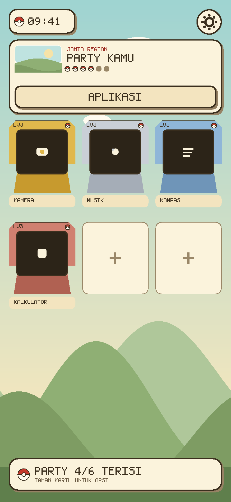

# PokeLauncher

Launcher Android native bergaya **Pokémon HeartGold / SoulSilver**: home screen pengganti dengan
enam slot "party", app drawer, jam HeartGold, dan setelan tampilan. Seluruh ilustrasi
(langit Johto, bukit, Poké Ball, kartrid GBA) digambar dari kode Compose — tanpa aset berhak cipta.



> Pratinjau di atas dibuat oleh `tools/render_preview.py` memakai palet warna asli dari
> `ui/theme/Theme.kt` dan tata letak `LauncherScreen.kt`. Ini pratinjau desain, bukan render emulator.

---

## Isi repo

```
app/src/main/java/dev/retrobit/pokelauncher/
├── MainActivity.kt              Activity tunggal, entry point HOME
├── data/
│   ├── Models.kt                AppEntry, PartySlot, LauncherSettings, LauncherUiState
│   ├── PartyRules.kt            Aturan party 6 slot (murni Kotlin, ada unit test)
│   └── LauncherRepository.kt    PackageManager, prefs, cache ikon
├── ui/
│   ├── LauncherScreen.kt        Root: wallpaper, top bar, party grid, modal
│   ├── LauncherViewModel.kt     StateFlow tunggal, semua I/O di Dispatchers.IO
│   ├── components/              HgPanel, HgButton, GameCard, Pokeball, ikon vektor
│   ├── screens/                 App drawer, settings, menu sheet, app info, dialog
│   └── theme/                   Palet HeartGold + 3 font pixel
└── res/                         strings (id + en), tema, ikon adaptive
tools/                           Skrip verifikasi & render pratinjau
docs/                            Gambar pratinjau
licenses/                        Lisensi OFL untuk font
```

## Cara build

Butuh Android Studio **Ladybug** (AGP 8.7) atau lebih baru, JDK 17.

```bash
# dari Android Studio: File > Open > folder ini, lalu Run
# atau dari terminal:
./gradlew assembleDebug        # APK debug di app/build/outputs/apk/debug/
./gradlew test                 # unit test PartyRules
./gradlew assembleRelease      # perlu signing config sendiri
```

`local.properties` (berisi `sdk.dir`) dibuat otomatis oleh Android Studio. Untuk build via CLI,
salin `local.properties.example` menjadi `local.properties` dan sesuaikan path SDK.

## Menjadikan launcher sebagai home screen

1. Install APK, buka aplikasinya sekali.
2. Tekan tombol **APLIKASI** lalu buka **Pengaturan → JADIKAN HOME DEFAULT**.
3. Di dialog sistem pilih **PokeLauncher**, lalu **Selalu**.

Di sebagian ROM (MIUI, ColorOS, One UI) dialog itu diganti halaman khusus: buka
*Settings → Apps → Default apps → Home app*. Jika perangkat gagal menampilkan dialog,
PokeLauncher otomatis membuka halaman info aplikasi sebagai fallback.

## Fitur

| Fitur | Detail |
| --- | --- |
| Party 6 slot | Favorit disimpan sebagai `package/activity`, bertahan setelah reboot & update. |
| Kartu kartrid | Kartrid GBA digambar per-langkah (`cartridgePath`), warna berbeda per slot. |
| Level | Naik dari jumlah peluncuran aplikasi (`1 + launches / 5`, maksimum 100). |
| App drawer | Pencarian instan, tambah/hapus party lewat Poké Ball, long-press untuk info. |
| Jam | `LaunchedEffect` bangun tepat di pergantian menit, tanpa wakelock. |
| App hilang | Slot menampilkan `???`; long-press untuk mengeluarkan dari party. |
| Layout adaptif | ≥700dp: pengaturan tampil sebagai panel samping, bukan layar penuh. |
| Lokalisasi | `values/` + `values-in/`, semua teks di `strings.xml`. |

## Keputusan teknis penting

- **Package visibility.** Android 11+ menyembunyikan aplikasi lain. Manifest mendeklarasikan
  `<queries><intent MAIN/LAUNCHER>` — bukan `QUERY_ALL_PACKAGES`, yang akan ditolak Play Store
  untuk launcher.
- **HOME intent filter** memakai `MAIN` + `HOME` + `DEFAULT`, `exported=true`,
  `stateNotNeeded=true`, `clearTaskOnLaunch=true`, `launchMode=singleTask`. Tanpa
  `stateNotNeeded` launcher bisa crash saat prosesnya dimatikan sistem.
- **Back tidak pernah menutup home.** Satu `BackHandler` aktif yang menutup layer teratas
  (dialog → sheet → drawer → settings) dan menelan tombol Back saat tidak ada layer, sehingga
  layar tidak pernah kosong.
- **Ikon dimuat di `Dispatchers.IO`** lewat `produceState`, lalu di-cache di `LruCache`. Cold start
  tidak memblokir frame pertama.
- **Tanpa simbol unicode di font pixel.** Press Start 2P/DotGothic16/Silkscreen tidak punya glyph
  `✕ ☰ ⚙ ⌕` (terbukti lewat pemeriksaan cmap font), jadi ikon digambar dengan `Canvas`.

## Verifikasi yang sudah dilakukan

Sandbox pengembangan tidak punya JDK/Android SDK dan akses Maven dibatasi, jadi build APK belum
dijalankan di sini. Sebagai gantinya ada dua skrip pemeriksaan deterministik:

```bash
python3 tools/static_check.py   # XML valid, referensi @resource, impor & delimiter Kotlin
python3 tools/verify.py         # alias version catalog, call-site Compose, kunci strings id/en
python3 tools/render_preview.py # regenerasi docs/preview-home.png
```

Keduanya lulus tanpa error pada commit ini. Tetap jalankan `./gradlew assembleDebug` sekali di
mesin Anda; jika ada error kompilasi, kirimkan log-nya ke sesi ini untuk diperbaiki.

## Kredit & lisensi

- Kode: Apache-2.0 (lihat pemilik repo).
- Font: [Press Start 2P](https://fonts.google.com/specimen/Press+Start+2P),
  [DotGothic16](https://fonts.google.com/specimen/DotGothic16),
  [Silkscreen](https://fonts.google.com/specimen/Silkscreen) — SIL Open Font License 1.1,
  teks lisensi lengkap di `licenses/`.
- Pokémon adalah merek dagang Nintendo/Game Freak/Creatures. Repo ini tidak memuat aset Pokémon
  apa pun; gaya visualnya hanya berupa palet warna dan bentuk geometris.
